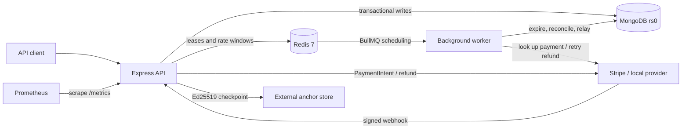
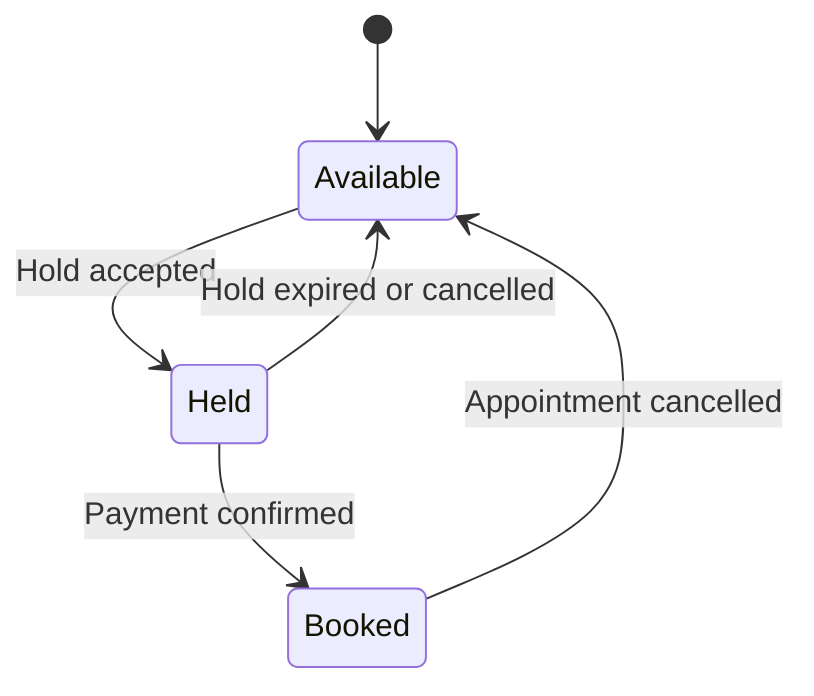
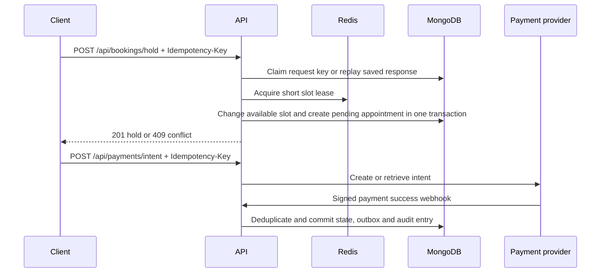

# MedCore

MedCore is a fault-tolerant distributed booking engine that keeps appointment slots consistent under contention and recovers payments after service or webhook failures.

## Quickstart

With Node.js 24 (or 20.19+) and Docker running, execute this from the repository root.

```sh
npm run quickstart
```

The command prepares a local `.env`, starts healthy MongoDB 7 (`rs0`) and Redis 7 containers, installs locked dependencies, and runs the integration suite. It generates local secrets when needed. The Redis kill test starts and destroys a separate disposable Redis container.

To run the API and the worker after setup, use separate terminals.

```sh
npm run dev
```

```sh
npm run build
npm run start --workspace @medcore/worker
```

- API documentation at [localhost:3000/api/docs](http://localhost:3000/api/docs) and [OpenAPI JSON](http://localhost:3000/api/docs.json)
- Operational endpoints at [health](http://localhost:3000/health), [readiness](http://localhost:3000/ready) and [metrics](http://localhost:3000/metrics)
- Development payment behavior and security configuration in [.env.example](.env.example)

## Architecture



## Booking state and request flow





### Five guarantees

1. **Concurrency control.** Redis rejects contention quickly with a short `SET NX PX` lease. A token-checking Lua script releases it safely. The authoritative transaction changes the slot only from `available`, creates one active appointment and stores the replayable response. MongoDB's partial unique index enforces at most one `pending_payment` or `confirmed` appointment per slot even when Redis is unreachable.
2. **Self-healing payments and outbox.** Stripe event IDs deduplicate concurrent delivery. Booking confirmation, payment state, audit entry and outbox event commit together. The worker expires holds, reconciles missed webhooks, and retries pending refunds. A late payment queues a durable, idempotent refund obligation. The outbox relay hands off to a durable MongoDB inbox.
3. **Envelope encryption with AAD.** Each prescription gets a fresh AES-256-GCM DEK, wrapped under a key-ring KEK. AAD binds encryption to the appointment and patient. KEK rotation rewraps the DEK while retaining the original ciphertext.
4. **Tamper-evident audit chain.** Every recorded event links to the previous entry hash and carries a payload hash. A transaction serializes appends. The external Ed25519 checkpoint can detect a rewritten chain even if the attacker also recomputes its database head.
5. **JWT family reuse detection.** Access JWTs expire after 15 minutes. Refresh tokens rotate within a family, and replay of a used token revokes that family. Already issued access JWTs expire normally.

## Measured results

Single-machine Windows/Docker development run using Node.js 24.14.0. Latencies are elapsed milliseconds, measured at the client or benchmark harness. These are observations under a hot-slot workload.

### End-to-end HTTP

The harness opens loopback TCP connections before timing, then pipelines 1,000 simultaneous HTTP requests over 20 established sockets with distinct patients and idempotency keys to one available slot. It checks status counts and the MongoDB appointment count.

| Requests | 201 | 409 | Double bookings | Throughput (req/s) | p50 (ms) | p95 (ms) | p99 (ms) |
| -------: | --: | --: | --------------: | -----------------: | -------: | -------: | -------: |
|     1000 |   1 | 999 |               0 |             222.71 |  3953.40 |  4485.36 |  4487.87 |

### Strategy comparison

Each strategy receives one excluded warm-up round and 10 measured rounds of 100 concurrent attempts against a fresh slot per round. The benchmark rotates strategy order, checks winners against persisted state, and reports double-booked **slots** per round. This microbenchmark isolates the contention primitive. The HTTP test above includes routing, validation, idempotency, and the booking transaction.

| Strategy                     | Attempts | Throughput (ops/s) | p50 (ms) | p95 (ms) | p99 (ms) | Double-booked slots |
| ---------------------------- | -------: | -----------------: | -------: | -------: | -------: | ------------------: |
| Unique index only            |     1000 |            1539.52 |    43.26 |    92.88 |   108.96 |        0/10 (0.00%) |
| Atomic conditional update    |     1000 |            2319.76 |    32.02 |    50.97 |    60.75 |        0/10 (0.00%) |
| Redis lock + atomic update   |     1000 |            7807.44 |     3.74 |    10.14 |    13.19 |        0/10 (0.00%) |
| Optimistic concurrency (__v) |     1000 |             948.68 |    89.41 |   185.39 |   193.79 |        0/10 (0.00%) |

### Chaos matrix

| Failure injected                                    | Assertion                                                                                                   |
| --------------------------------------------------- | ----------------------------------------------------------------------------------------------------------- |
| Disposable Redis process killed                     | MongoDB accepts one of 50 requests, returns 49 conflicts, and persists one active appointment.              |
| Same Stripe webhook sent five times concurrently    | One processing response, four duplicate responses, one event record, one outbox event, and one audit entry. |
| Hold expires at the deadline before webhook arrival | Payment is refunded, the old appointment remains expired and its slot remains available.                    |
| Successful Stripe webhook never delivered           | Reconciliation confirms the appointment and books the slot without inserting a webhook event.               |

Reproduce with Docker running.

```sh
docker compose up -d --wait
npm run test:chaos
npm run benchmark
```

Set `BENCH_ROUNDS` and `BENCH_CONCURRENCY` to override the microbenchmark defaults. The HTTP suite and strategy benchmark create and clean up isolated MongoDB databases.

### k6 against a running API

Use a fresh available slot and a patient access token from a development environment. In PowerShell, set the following values and run k6. Use a new run ID for each run. For the full burst, keep the API rate limit above the planned request count plus setup traffic.

```powershell
$env:BASE_URL = 'http://127.0.0.1:3000'
$env:SLOT_ID = '<available-slot-id>'
$env:ACCESS_TOKEN = '<patient-access-token>'
$env:RUN_ID = [Guid]::NewGuid().ToString()
$env:REQUESTS = '1000'
k6 run loadtest/booking.k6.js
```

Alternatively set `TOKENS_FILE` to a JSON array of patient JWTs. k6 checks HTTP outcomes and exactly one `201`. The Vitest suite verifies persisted state.

## Design and security records

- [ADR 001 · Modular monolith and outbox](docs/adr/001-modular-monolith-and-outbox.md)
- [ADR 002 · Dual-layer concurrency control](docs/adr/002-dual-layer-concurrency-control.md)
- [ADR 003 · Envelope encryption and key management](docs/adr/003-envelope-encryption-and-key-management.md)
- [ADR 004 · Tamper-evident audit chain](docs/adr/004-tamper-evident-audit-chain.md)
- [STRIDE threat model and GDPR/security notes](docs/threat-model.md)

The web workspace is a scaffold, and the integration suite uses the local Stripe provider. Deployment needs independently protected anchor storage and application secrets, TLS, and network access controls.
